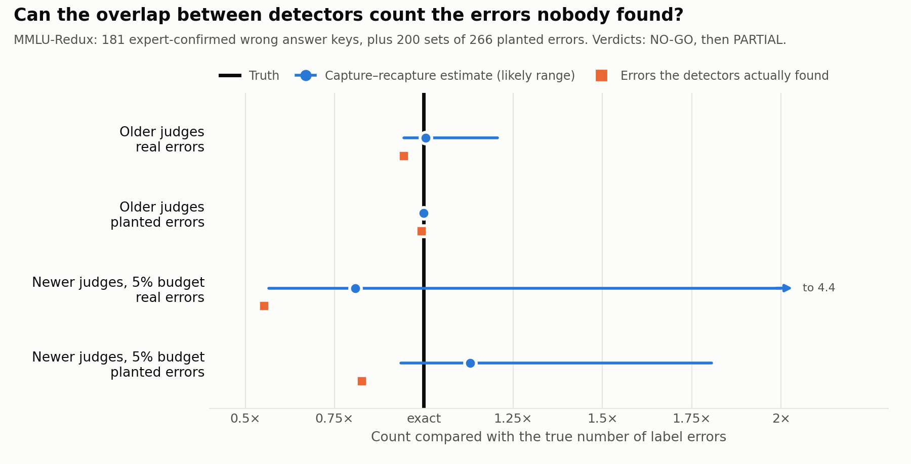

<div align="center">

# How Many Label Errors Are Left?
### Capture–Recapture for Counting the Benchmark Errors Nobody Found

**Parit Kansal**
Independent Researcher · [paritkansal.in](https://paritkansal.in) · [OpenReview](https://openreview.net/profile?id=~Parit_Kansal1) · [GitHub](https://github.com/ParitKansal)

October 2026

[](experiments/kill_v2/PREREG.md)
[](experiments/kill_v1/RESULTS.md)
[](experiments/kill_v2/RESULTS.md)
[](https://doi.org/10.5281/zenodo.23205993)
[](LICENSE)
[](https://creativecommons.org/licenses/by/4.0/)
[](experiments/kill_v2/notebooks/)

</div>

---

## Abstract

Benchmarks contain wrong answer keys, and the tools that find them always miss some, so published error counts are lower bounds. We ask whether a tool from ecology can count the errors that no tool found. **Capture–recapture** estimates the size of an animal population from the overlap between several imperfect surveys; we treat each label-error detector as a survey and the overlap between their findings as evidence of how many errors went unseen. We test the idea in two pre-registered experiments on MMLU-Redux, where experts re-checked 5,700 MMLU questions and found 181 wrong answer keys, and on 200 sets of 266 errors that we planted ourselves. In the first experiment, four 2024-era LLM judges and confident learning flagged between 16% and 64% of all questions each; together they found 171 of the 181 errors, so almost nothing was left to estimate, and the experiment fails by its own rules even though the estimate (181.9) was almost exact. In the second, three current open models and confident learning each flagged only their 285 most suspicious questions, as a real audit would; together they found 100 of the 181 errors. The estimator's intervals contained the truth in 97% of planted-error trials, but they were so wide, and its point estimates so variable, that on average it was further from the truth than simply counting what the detectors found. Capture–recapture over a handful of automated detectors is well calibrated but too imprecise to be useful. Along the way we find that current LLM judges miss about a third of known MMLU errors even without a budget, that confident learning out-performs every LLM judge, and that planted errors are far easier to detect than real ones. We release the designs, code, executed analyses and all detector outputs.

<p align="center">
<picture>
  <source media="(prefers-color-scheme: dark)" srcset="figures/results-dark.png">
  
</picture>
</p>

**Figure 1.** Every count is shown relative to the true number of errors, so the black line at "exact" is the truth. The orange square is what the detectors actually found; the blue dot is the capture–recapture estimate and the blue line its likely range (for real errors, the 95% interval; for planted errors, the middle 80% of the estimates over 200 trials). With the older judges the detectors already found nearly everything. With the newer judges they missed a lot, but the estimate became too uncertain to help.

**Contents:** [1. Motivation](#1-motivation) · [2. Approach](#2-approach) · [3. Study design](#3-study-design) · [4. Experiment 1](#4-experiment-1-older-judges) · [5. Experiment 2](#5-experiment-2-newer-judges-with-a-budget) · [6. What we learned](#6-what-we-learned) · [7. Limitations](#7-limitations) · [8. Reproducibility](#8-reproducibility) · [9. Related work](#9-related-work) · [References](#references) · [Citation](#citation)

---

## 1. Motivation

A benchmark is a list of questions with answer keys, and some of those keys are wrong. When a key is wrong, a model that answers correctly is marked as failing, so every wrong key adds noise to the scores that decide which model is "best". The differences between top models on popular benchmarks are often a point or two, about the same size as the share of broken questions.

People look for wrong keys with detectors. A strong model may disagree with the key, a judge model may say the question is broken, or a statistical method such as confident learning [12] may mark the item as suspicious. Each detector finds some errors and misses others, so the number of errors found is always smaller than the number that exist. Published audits therefore report lower bounds, in the form "at least 3.3% of the test set is mislabelled" [11]. Nobody reports how many errors are still hidden, because there has been no way to estimate the ones that every detector missed.

## 2. Approach

Ecologists faced the same problem with animals more than a century ago. To count the fish in a lake, catch some on day one, mark them and release them. Catch again on day two. If half of the second catch is already marked, the first catch saw about half the population, so the lake holds about twice the first catch. This is the Lincoln–Petersen estimator, and its descendants handle many surveys at once. Log-linear models [5] allow the surveys to depend on one another, Chao's estimators [4] give a safe lower bound when some animals are much harder to catch than others, and the jackknife of Burnham and Overton [3] targets that same unevenness directly. Epidemiologists use these tools to count hidden populations from overlapping hospital, police and clinic lists, and software engineers used them to estimate how many defects remained after several inspectors read the same code [2, 14].

Here the animals are wrong answer keys and the surveys are detectors. Each detector flags questions, a person checks only the flagged ones, and every confirmed error is a capture. The pattern of which detectors caught which errors then gives an estimate of the total, including the errors no detector caught, with a confidence interval. If it worked, it would turn "at least N errors" into "about M errors, of which N have been found", and it would tell an audit team when adding another detector stops paying off. Three independent literature searches found no previous use of this idea for machine-learning benchmarks ([novelty check](literature/NOVELTY.md)). The closest work flags errors with single detectors [9, 11, 16] or with pooled LLM judges [10], and reports what was found.

## 3. Study design

To know whether an estimate is right, we need a benchmark where the true number of errors is already known. MMLU-Redux [6] provides one: experts re-checked 5,700 questions from the MMLU benchmark [7], 100 from each of its 57 subjects, and labelled 181 of them as having a wrong, missing or ambiguous answer key. Because one round of expert checking can itself miss errors, we also built a second test with exactly known truth. We took questions the experts had marked as correct, swapped the answer key of 266 of them to a wrong option, and repeated this with 200 different random choices. Every detector saw every question with its four options shuffled into a fixed random order, so that a model which had memorised "the answer is C" from the public benchmark could not use that memory.

Everything that decided the outcome was written down and committed before any model was run: the detectors, the rule for when a detector flags a question, the estimator, how its interval is computed, and four conditions for success. The method had to (a) put the true count inside its 95% interval in at least 85% of the planted-error trials, (b) cover the 181 real errors, (c) face detectors that together miss at least 20% of the real errors, since otherwise there is nothing to estimate, and (d) land at least twice as close to the truth as simply counting what the detectors found, both on the real errors and on average over the planted ones. Before each experiment we also ran a simulation study of the estimator on artificial data. That is where several design choices were made, and where the method's known failure mode was measured in advance: it undercounts when some errors are invisible to every detector. The full rules are in the two pre-registrations, for [experiment 1](experiments/kill_v1/PREREG.md) and [experiment 2](experiments/kill_v2/PREREG.md).

## 4. Experiment 1: older judges

The first experiment used four instruction-tuned models released before MMLU-Redux was published, so that none of them could have seen its corrections: Llama-3-8B, Mistral-7B, Qwen2-7B and Phi-3-medium. Each acted as a judge, shown a question with its key and asked whether the key was correct. A fifth detector, confident learning [12], used the same four models' answer probabilities without showing them the key. A question counted as flagged when a judge answered INCORRECT.

The estimator worked well. On the real benchmark it estimated 181.9 errors against the expert count of 181, and on the planted errors its interval contained the truth in all 200 trials. But the judges flagged far too much. They called between 35% and 64% of all questions wrong, with precision between 4% and 7%, and together they flagged 4,145 of the 5,700 questions. Flagging almost everything catches almost every error: the detectors found 171 of the 181 real errors, and on average 264 of the 266 planted ones. With only 5.5% of errors left unfound there was nothing worth estimating, so conditions (c) and (d) failed and the experiment was a NO-GO by its own rules ([results](experiments/kill_v1/RESULTS.md)). A side check found no clear sign that these models had memorised the positions of MMLU's answers.

## 5. Experiment 2: newer judges with a budget

The second experiment changed what the first had shown to be wrong. It used three current open models from three different companies, Gemma-4-31B, Qwen3.8-27B with its reasoning mode switched off, and Mistral-Small-4, again with confident learning as a fourth detector. Instead of a yes-or-no verdict, each judge gave the probability that the key is wrong, and each detector flagged only its 285 most suspicious questions, 5% of the benchmark, which is the scale a team of people could actually check. The simulation run before any data were collected showed that, with only four detectors, a different way of computing the interval held its coverage better, and that choice was made and recorded before the run.

This time the detectors behaved like real auditors. Together they flagged 742 questions and found 100 of the 181 real errors, missing 45%. Confident learning was the best single detector, with 46% recall and 30% precision, ahead of Gemma (39% and 25%), Qwen (21% and 13%) and Mistral (10% and 7%). The estimator was honest: its intervals contained the true count in 97% of the planted-error trials and contained the 181 real errors. But they did so by being very wide. The interval on the real benchmark ran from 102 to 797, and the median interval on the planted errors was 681 errors wide on a true count of 266. The point estimate moved a long way between trials and overshot the truth three times out of four. On average it was 95 errors away from the truth, while the plain count of what the detectors found was 46 away. Condition (d) failed, and the experiment ended as PARTIAL ([results](experiments/kill_v2/RESULTS.md)).

## 6. What we learned

The central finding is that capture–recapture over a handful of automated detectors is **well calibrated but not precise enough to be useful**. When detectors flag generously, they find nearly everything and there is nothing left to estimate. When they flag selectively, as a real audit must, the overlap between three or four detectors of very uneven skill is too thin to pin the total down. This repeats, on a new kind of data, the main warning from software inspection research: with few inspectors of uneven ability, these estimators become unreliable [2].

Three further results stand on their own. First, current LLM judges still miss about a third of known errors. Used without any budget, the three newer judges together flagged 1,869 questions and found 125 of the 181, so even a generous audit by today's open models leaves many errors unfound. Second, confident learning, a simple statistical method, found more errors with fewer false alarms than any LLM judge, in both experiments. Third, planted errors are much easier to find than real ones. The newer judges called 75% to 91% of the swapped keys wrong but found only about 55% of the real errors, so tests built on planted errors overstate how well any error-counting method will work on a real benchmark.

## 7. Limitations

The ground truth is one round of expert checking, and MMLU-Redux's own annotators marked 32 questions as needing more expertise than they had. Some questions it calls correct may be wrong, so the real-error test is a realism check rather than an exact one, which is why the planted errors carried the main calibration test. The newer models were released after MMLU-Redux and may have seen its corrections, which could only make them look better at finding the real errors. Only one benchmark was studied, and its errors are heavily concentrated, with virology alone holding 41 of the 181. The 5% budget in the second experiment is a reasonable choice rather than a derived one, and a larger budget or more detectors might give tighter estimates. We did not test that, because it would have been a third attempt to rescue the same idea after two failures, which is exactly what pre-registration is meant to prevent.

## 8. Reproducibility

Each experiment has its own folder under [`experiments/`](experiments/). In it, `PREREG.md` is the design as committed before the run, `RESULTS.md` the outcome judged against it, `simulation_coverage.txt` the simulation study, `src/` the estimators and detectors with their tests, `notebooks/` the Google Colab notebooks that ran the models and the analysis, and `data/` every detector output and the analysis summary. The analysis can be repeated on a laptop from the files in `data/` without running any model. The estimators in `crc.py` need only NumPy and SciPy and were checked against published closed forms. The models ran with vLLM [8] on single Colab GPUs, a few GPU-hours in total. The dataset is pinned to revision `372ea425445d51e1ba1188c56e5e893f8138621f` of `edinburgh-dawg/mmlu-redux-2.0`, and [`experiments/kill_v1/DATA.md`](experiments/kill_v1/DATA.md) lists its error counts by subject. Every reference was opened and checked before it was cited; the reading list with notes is in [`literature/`](literature/).

## 9. Related work

Label errors in test sets became a widely discussed problem after Northcutt and colleagues used confident learning to estimate that at least 3.3% of the labels in ten common test sets are wrong [11, 12]. For language-model benchmarks, MMLU-Redux re-annotated part of MMLU by hand [6], Nahum and colleagues used ensembles of LLM judges to flag label errors [10], Land and Bikel used item response theory over the responses of more than a hundred models [9], and Truong and colleagues combined response statistics with an LLM judge to decide which items to send for expert review [16]. All of these find errors; none estimates how many remain. Capture–recapture itself has a long history in ecology [13], with the log-linear [5], unequal-catchability [4] and jackknife [3] models used here, small-sample results for the two-list case [15] and a standard software implementation [1]. Its closest previous use outside ecology is counting remaining software defects from the overlap between code inspectors [2, 14], which is also where its main weakness was first documented.

## References

[1] S. Baillargeon and L.-P. Rivest. The Rcapture package: loglinear models for capture-recapture in R. *Journal of Statistical Software*, 19(5), 2007.

[2] L. C. Briand, K. El Emam, B. G. Freimut and O. Laitenberger. A comprehensive evaluation of capture-recapture models for estimating software defect content. *IEEE Transactions on Software Engineering*, 26(6):518–540, 2000.

[3] K. P. Burnham and W. S. Overton. Estimation of the size of a closed population when capture probabilities vary among animals. *Biometrika*, 65(3):625–633, 1978.

[4] A. Chao. Estimating the population size for capture-recapture data with unequal catchability. *Biometrics*, 43(4):783–791, 1987.

[5] S. E. Fienberg. The multiple recapture census for closed populations and incomplete 2^k contingency tables. *Biometrika*, 59(3):591–603, 1972.

[6] A. P. Gema, J. O. J. Leang, G. Hong, A. Devoto, A. C. M. Mancino, R. Saxena, X. He, Y. Zhao, X. Du, M. R. G. Madani, C. Barale, R. McHardy, J. Harris, J. Kaddour, E. van Krieken and P. Minervini. Are we done with MMLU? In *Proceedings of NAACL*, 2025.

[7] D. Hendrycks, C. Burns, S. Basart, A. Zou, M. Mazeika, D. Song and J. Steinhardt. Measuring massive multitask language understanding. In *Proceedings of ICLR*, 2021.

[8] W. Kwon, Z. Li, S. Zhuang, Y. Sheng, L. Zheng, C. H. Yu, J. E. Gonzalez, H. Zhang and I. Stoica. Efficient memory management for large language model serving with PagedAttention. In *Proceedings of SOSP*, 2023.

[9] S. Land and D. M. Bikel. Auditing LLM benchmarks with item response theory. arXiv:2605.30504, 2026.

[10] O. Nahum, N. Calderon, O. Keller, I. Szpektor and R. Reichart. Are LLMs better than reported? Detecting label errors and mitigating their effect on model performance. In *Proceedings of EMNLP*, 2025.

[11] C. G. Northcutt, A. Athalye and J. Mueller. Pervasive label errors in test sets destabilize machine learning benchmarks. In *NeurIPS Datasets and Benchmarks Track*, 2021.

[12] C. G. Northcutt, L. Jiang and I. L. Chuang. Confident learning: estimating uncertainty in dataset labels. *Journal of Artificial Intelligence Research*, 70, 2021.

[13] D. L. Otis, K. P. Burnham, G. C. White and D. R. Anderson. Statistical inference from capture data on closed animal populations. *Wildlife Monographs*, 62:3–135, 1978.

[14] H. Petersson, T. Thelin, P. Runeson and C. Wohlin. Capture–recapture in software inspections after 10 years research: theory, evaluation and application. *Journal of Systems and Software*, 72(3):249–264, 2004.

[15] L.-P. Rivest and M. Yauck. Small sample inference for two-way capture recapture experiments. arXiv:2307.11705, 2023.

[16] S. Truong, Y. Tu, M. Hardy, A. Reuel, Z. Tang, J. Burapacheep, J. Perera, C. Uwakwe, B. Domingue, N. Haber and S. Koyejo. Fantastic bugs and where to find them in AI benchmarks. arXiv:2511.16842, 2025.

## Citation

If you use this work, please cite:

```bibtex
@misc{kansal2026labelerrorcapturerecapture,
  author       = {Kansal, Parit},
  title        = {How Many Label Errors Are Left? Capture--Recapture for Counting the Benchmark Errors Nobody Found},
  year         = {2026},
  month        = oct,
  publisher    = {Zenodo},
  doi          = {10.5281/zenodo.23205993},
  url          = {https://doi.org/10.5281/zenodo.23205993},
  howpublished = {\url{https://github.com/ParitKansal/label-error-capture-recapture}},
  note         = {Pre-registered negative result. GitHub repository}
}
```

The **Cite this repository** button on the right of this page provides the same reference in other formats.

## Acknowledgements

This work uses the MMLU-Redux dataset [6], built on MMLU [7], and open models from Meta, Mistral AI, Alibaba (Qwen), Microsoft and Google, each used under its own licence. The confident-learning detector uses the cleanlab library. Literature searches and code were developed with the assistance of an AI system (Claude); all experiments were run and all results verified by the author.

## License

The code is released under the [MIT License](LICENSE). The text and figures are released under [CC BY 4.0](https://creativecommons.org/licenses/by/4.0/).
